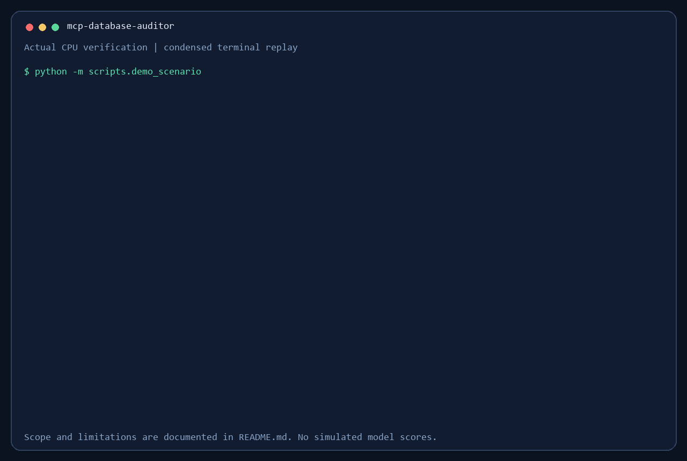

# MCP Database Auditor

A local-first MCP prototype for database schemas, conservative SQL policy, result profiling and query-plan inspection.

## Implemented
- Five FastMCP tools: execute_safe_query, profile_table, get_database_health, analyze_query_plan, schema_changes.
- Resources: schema://current and schema://table/{table_name}.
- SQLGlot checks every statement and nested node; blocks DDL/DML, SELECT INTO, locks, unallowlisted functions and unbounded LIMIT expressions.
- SQLite read-only connections and interruptible deadlines. PostgreSQL read-only configuration is applied per transaction.
- JSONL audit records with normalized query fingerprints; literals and full SQL are not logged.
- Schema comparison against the previous in-process snapshot.
- Actual EXPLAIN plans; full scans are reported as candidates, since scans can be optimal.

~~~mermaid
flowchart LR
  Client[MCP client] --> Tools[Tools]
  Tools --> Policy[SQL AST checks]
  Policy --> DB[Read-only database]
  DB --> Result[Rows / schema / plans]
  Result --> Report[Profile / audit / response]
~~~

## Run
~~~sh
python -m venv .venv
# Activate your environment, then:
pip install -e ".[dev]"
python scripts/seed_demo_db.py
python server.py
python client_test.py
python -m pytest -q
~~~
DATABASE_URL selects an existing database; otherwise the local SQLite demo initializes lazily. AUDIT_LOG_PATH selects the JSONL audit file. Default transport is stdio. Local SSE: python server.py --transport sse --host 127.0.0.1 --port 8000.

## Measured evidence
Recorded Windows/Python 3.13 run: **58 passed, 1 PostgreSQL integration test skipped**. The real stdio MCP harness also passed.

| Operation | Median | p95 |
|---|---:|---:|
| Schema reflection | 14.80 ms | 15.80 ms |
| SQL policy check | 0.445 ms | 0.591 ms |

Thirty runs against the seeded five-table local SQLite fixture, including first sample. These are not PostgreSQL/network/load guarantees. [Raw samples](docs/evidence/sqlite-benchmark.json).
Reproduce: python benchmark.py --repeats 30 --output benchmark-results.json.

## PostgreSQL
Compose provisions a separate SELECT-only reader and owner. Run docker compose up --build, set TEST_POSTGRES_URL to the disposable reader URL from docker-compose.yml, then run python -m pytest tests/test_postgres_integration.py -q.
CI provisions PostgreSQL separately. **Docker/PostgreSQL were not available on the repair host; this path remains unverified until run.**

## Boundaries
- Local/trusted use only; SSE has no user/tenant authentication.
- Parser policy complements least-privilege DB roles; it is not a complete SQL security boundary.
- Table profiles cover the first 100 returned rows, not a representative whole-table sample.
- Schema snapshots reset on process restart. JSONL is not a centralized durable audit system.
- The function allowlist rejects some legitimate SQL. Index metadata is heuristic; planner output needs interpretation.

## Demonstration

[Static PNG](assets/demo.png) | [Raw commands and output](assets/demo-transcript.json)

These assets are condensed terminal replays rendered from actual subprocess output. They are not screenshots of a production deployment.
Regenerate: install requirements-demo.txt, then run python scripts/render_demo.py.

[Engineering changes and ownership exercises](OWNERSHIP.md)
